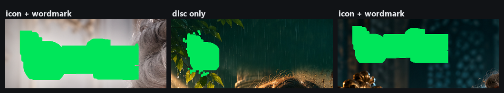
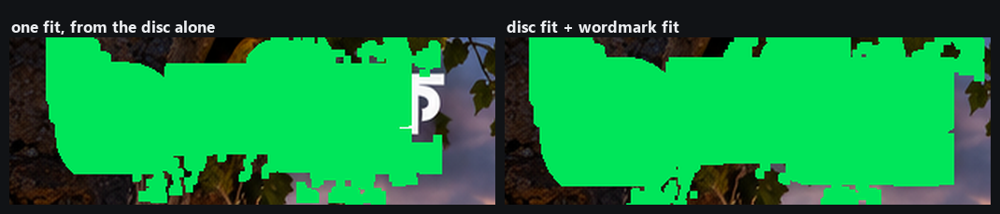
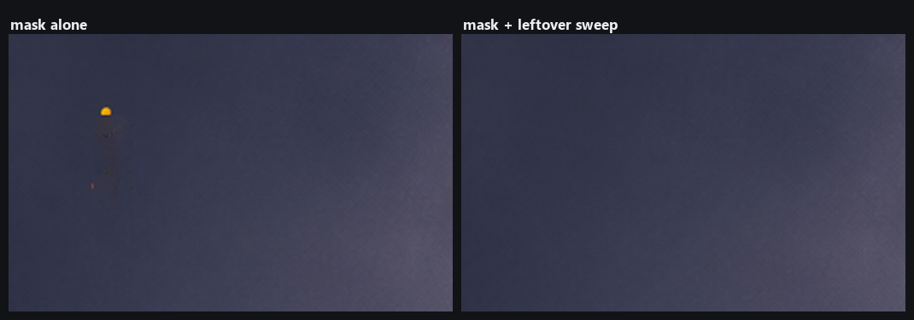

# Custom Photo Resizer

Takes a folder of Kabbik poster artwork, finds the Kabbik logo wherever it was placed, paints
it out, and writes a WebP that lands just under a size budget — at the original pixel
dimensions.


```bash
pip install -r requirements.txt
python kabbik_batch.py "Current Task" -o output
```

On the set in this repository: **192 files, logo found and removed in 48, none over 100 KB,
every output the same pixel size as its source.** The results are in [`output/`](output/).

---

## How it works

Two stages. Images with no logo skip the first one, so a mixed folder sorts itself out.

### 1. Find the logo, and only the logo

`assets/logo.png` is the brand logo with its own alpha channel. Everything is derived from it
— cropped to its alpha bounding box, scaled to 400px wide. There is no hand-measured geometry
in the code; swap the asset and the anchors move with it.

The logo is placed by hand on each poster, so position and size vary. The wordmark is drawn
light on some posters and dark on others. The one stable landmark is the magenta play-button
disc, so that is the anchor: multi-scale `TM_SQDIFF_NORMED`, masked to the disc's circle *and*
its alpha, so the transparent cut-outs where the bubble outlines cross it — poster showing
through, not logo — do not count toward the match.

Then two gates, measured over all 192 posters:

| | real logo | false positive |
|---|---|---|
| match score (lower is better) | ≤ 0.071 | ≥ 0.236 |
| magenta filling the disc box | ≥ 68% | — |

Gates sit in the gap, at 0.15 and 40%. That is what keeps a deep-red corner or a maroon sky
from being mistaken for the disc.

**Is the wordmark there?** Some posters carry only the disc, and on those the artwork often
starts immediately to the right of it — erasing a wordmark-sized rectangle anyway would eat
real content. Both wordmark variants are compared through a local-background difference map,
which keys on *where* the contrast is rather than its sign, so light and dark text score
alike. Absent scores ≤ 0.07, present ≥ 0.21; the gate is 0.14. All 48 were called correctly.



### 2. Paint it out

[LaMa](https://github.com/advimman/lama), via the TorchScript build published by
[simple-lama-inpainting](https://github.com/enesmsahin/simple-lama-inpainting). Weights
(~200 MB) are fetched to `assets/big-lama.pt` on first run.

It runs on a window around the hole, scaled to ~512px, not on the whole poster — **16× faster**
(0.85s vs 13.6s per poster on CPU), and the model sees the hole at the share of the frame it
was trained for. Every pixel outside the mask is copied through bit-exact.

`--inpaint telea` falls back to OpenCV and needs no torch. It smears visibly on detailed
backgrounds; it is there so the pipeline still runs, not because it looks good.

---

## Three things that were harder than they looked

Each figure below is rendered by `tools/make_docs.py`, which runs the real pipeline twice —
once with the fix switched off. The figures cannot drift away from the code.

### The posters use two different lockups

Some posters set the wordmark wider against the same disc. A scale fitted to the disc lands
the disc perfectly and leaves the far end of the wordmark uncovered — no single rigid
placement sits on both ends at once.



So the alpha is stamped twice: the icon at the disc fit, and the wordmark at a second fit that
matches the logo's silhouette against the poster's own contrast map. Each end gets the fit
that is exact for it.

### The logo's last pixels sit outside the stamp

The logo on these posters was scaled and re-saved by hand, so its outermost rim can land a
pixel or two beyond a perfectly-placed stamp — and those pixels get copied straight through.
On a dark sky a three-pixel bubble rim is a bright orange dot.



A thin ring hugging the mask is swept for two signatures: the brand's magenta and orange, and
— for the white wordmark, which no colour rule would catch — anything standing far off its
local background. Only small blobs are taken, so an adjacent leaf or wall is left alone while
a three-pixel speck is not.

The thresholds sit *below* what the logo asset itself measures, because that rim blends with
the poster behind it and comes out darker and less saturated than the solid artwork. Over-
reaching costs a few pixels that were about to be repainted anyway; under-reaching leaves a
speck.

### The inpainter invents things

LaMa occasionally drops a speck into an otherwise plain fill — a bright dot in a night sky, a
pale smudge on a dark wall. Everything inside the mask is invented anyway, so a small blob
that disagrees sharply with its own surroundings is replaced by them. Bounded to small blobs,
so larger reconstructed structure survives, and to the mask interior, so the seam with the
real photo is untouched.

---

## Hitting the size budget

Pixel dimensions never change. The posters are cut to fixed sizes and stay that way.

Binary search on WebP quality (0–95) for the highest value that still fits. That carries
everything up to about 2 megapixels.

It cannot carry a 3840×2160 hero banner. 100 KB over 8.3 megapixels is about **0.1 bits per
pixel**; WebP at quality 0 still lands near 200 KB. Past that point the only currency left is
detail, so the image is scaled down and back up to its original size in 15% steps until a
quality search fits. The file keeps its dimensions and gets softer.


That is the worst of the 17 banners this happened to — down to 7% detail. The run prints
`detail NN%` on those lines and ends with them listed out, because this is a decision, not a
detail: **raise `--budget` for files like these**, or accept that they are mush.

---

## Watching a run

Every processed file prints its own line, prefixed with the percentage done. A long batch owns
the terminal though, so the run also mirrors its counters to `<out>/.kabbik-run.json` after
every file. From another terminal, or after the fact:

```bash
python kabbik_batch.py --status -o output
```

```
Current Task -> output
 46.9% █████████████░░░░░░░░░░░░░░░ 90/192   running
  elapsed 3m40s · 2.4s per file · eta 4m05s
  logos removed 24 · over budget 0 · detail dropped 3 · 7.8 MB written
  now: Kabbik Gallery/Uploded Done/.../kobori_push-notification_2048x1024_2x1.png
```

It reports `finished … ago, took …` once done, and `STALLED` if a run stopped partway, so
"still going" and "died an hour ago" do not look alike. Writing that file can never fail the
batch.

---

## Options

| flag | default | |
|---|---|---|
| `-o, --out` | `output` | output root; the input folder structure is mirrored |
| `--budget` | `102400` | max bytes per file |
| `--inpaint` | `auto` | `auto`, `lama`, or `telea` |
| `--keep-logo` | off | skip detection, only re-encode |
| `--dry-run` | off | report what would be detected, write nothing |
| `--status` | off | report how the run writing to `--out` is doing, then exit |

`python test_detect.py` composites the real logo onto synthetic posters and checks that the
finder puts it back where it was put, keeps disc-only apart from the full lockup, covers every
logo pixel with the mask, and stays quiet on an image with no logo.

---

## Known limits

- The logo is only looked for in the top-left corner (22% of the width, 14% of the height).
  One placed elsewhere will not be found.
- Whether the wordmark is present is decided from local contrast. On a background busy enough
  to rival the wordmark's own contrast the test can read low, and only the disc gets erased.
  `--dry-run` prints the verdict per file, so a wrong call is visible before anything is written.
- Torch on Python 3.15 is CPU-only at the time of writing, so LaMa runs on the CPU — correct,
  but slower than it needs to be. On a Python with CUDA wheels it picks the GPU up by itself.
- The leftover sweep keys on the Kabbik palette and on local contrast. A different logo needs
  `BRAND_COLOUR` re-measured from its own artwork.

## Retuning for a different logo

Replace `assets/logo.png` with the new logo on transparency and set `SPLIT_X` / `TEXT_X0` to
the empty column band between its icon and its wordmark, measured after the canonical resize
(alpha bbox, 400px wide). The disc anchor is found automatically, but it assumes the icon's
largest inscribed circle is the distinctive part. Run `--dry-run` and check that the match
scores still separate real hits from false ones.
